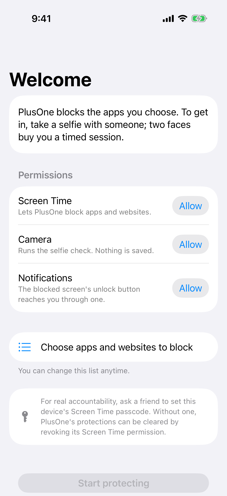
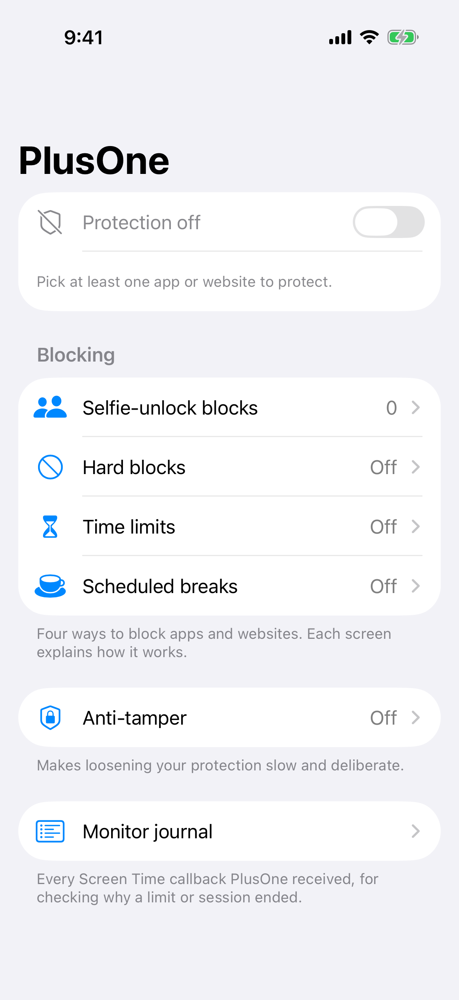
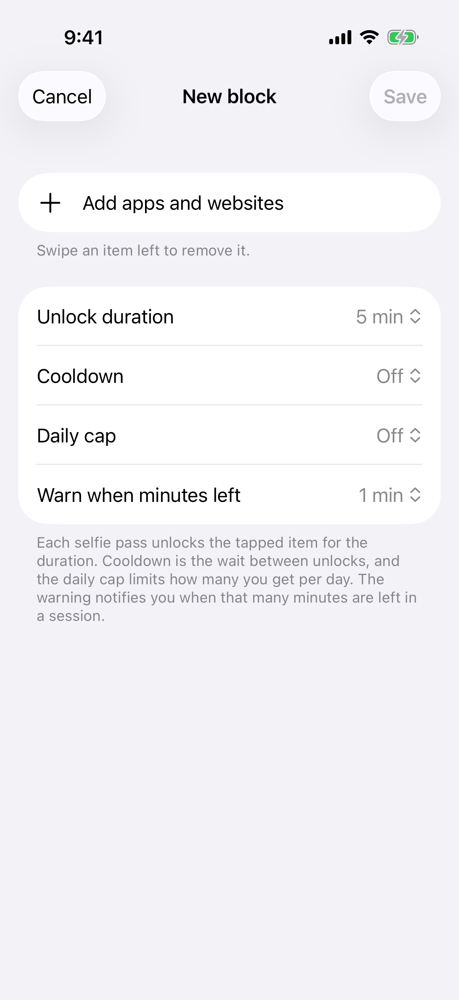
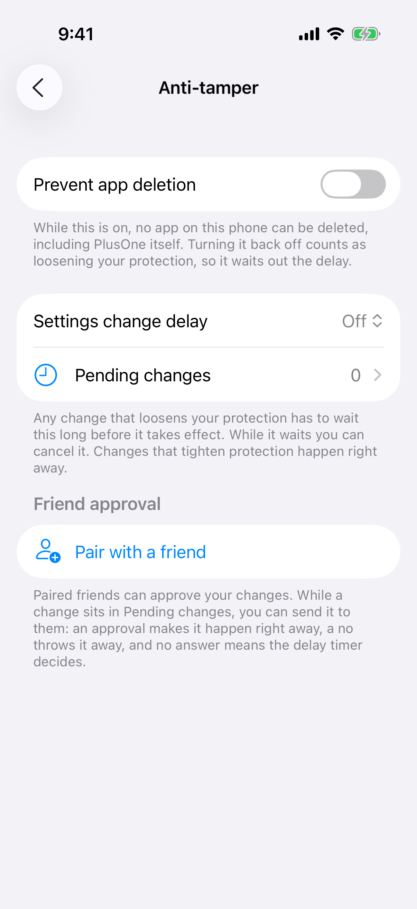

# PlusOne

An iOS app that blocks the apps and websites you choose. To open one, take a
selfie with at least one other person in it. Pass the check and you get a
timed session; when it ends, the block comes back on its own.

Doomscroll if you must, but not alone.

<p>
  
  
  
  
</p>

## How unlocking works

1. Opening a blocked app shows a block screen with one button: **Unlock with a
   selfie**. It opens PlusOne through a notification.
2. PlusOne checks the front camera live. It passes when two faces, each close
   enough to be physically present, stay in frame for 1.5 seconds of
   continuous video. A blink or a dropped frame does not reset the hold.
3. On iPhones with a TrueDepth camera, each face must also have real 3D depth
   (a nose closer than the cheeks), which rejects photos and screens.
4. A pass unlocks the item you tapped for its session length. iOS Screen Time
   re-locks it when the time is used, whether or not PlusOne is running.

Optionally, each passing selfie is saved to your photo library.

## Ways to block

| Type              | Behavior                                                                                                   |
| ----------------- | ---------------------------------------------------------------------------------------------------------- |
| Selfie-unlock     | Blocked until a selfie passes. Each block sets its own unlock length, cooldown, daily cap, and warning.    |
| Hard block        | Always blocked, no unlock. Includes Apple's adult-content filter for Safari.                                |
| Time limit        | A shared pool of minutes per hour or per day. When it runs out, the items block until the period resets.   |
| Scheduled break   | A daily window with a minute budget during which every block is lifted.                                    |

## Anti-tamper

Weakening your setup is slow and visible on purpose:

- **Settings change delay**: any change that loosens protection waits 1 to 72
  hours, with a countdown and a cancel button. Tightening applies at once.
- **Prevent app deletion**: while on, no app on the phone can be deleted,
  PlusOne included.
- **Friend approval**: pair with friends through iCloud. A pending change can
  be sent to them; approval applies it now, denial discards it, and no answer
  leaves it to the delay.

## Privacy

Everything runs on the device. No server, no accounts, no analytics. Camera
frames are analyzed in memory and discarded. Friend approval uses CloudKit,
and only the approval requests and answers leave the phone.

## Built with

SwiftUI, Screen Time APIs (FamilyControls, ManagedSettings, DeviceActivity),
AVFoundation and Vision for the face check, CloudKit for friend approval.

## Build

Requires Xcode and [XcodeGen](https://github.com/yonaskolb/XcodeGen).

```sh
brew install xcodegen
xcodegen generate
open PlusOne.xcodeproj
```

Blocking and the camera need a physical iPhone and the Family Controls
capability. The simulator runs the UI only.

## Limitations

- Revoking PlusOne's Screen Time permission in iOS Settings removes every
  block, including delete prevention. A Screen Time passcode held by a friend
  closes that gap.
- The face check is a nudge, not biometric security. A determined person can
  get past it.
